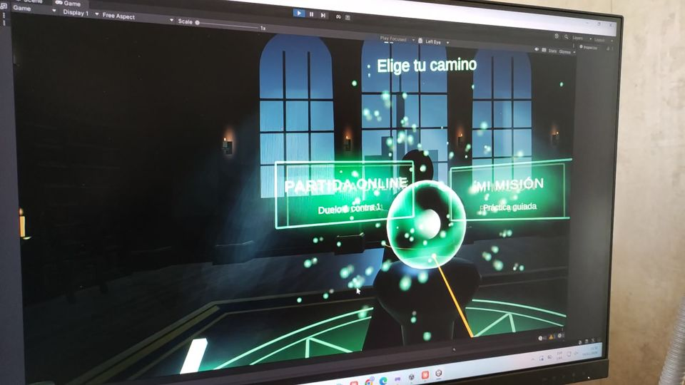
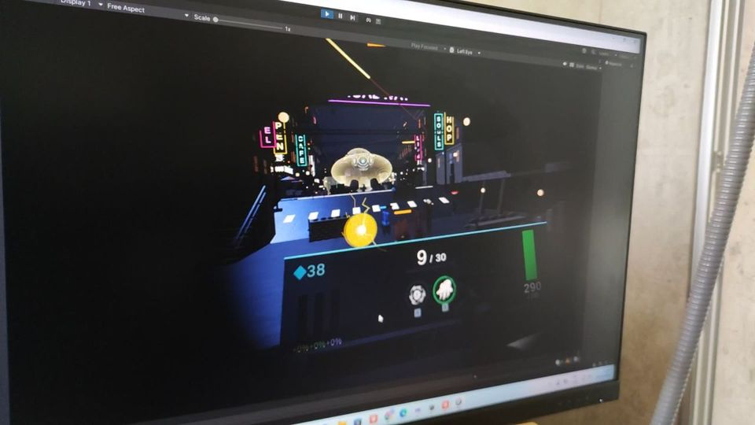
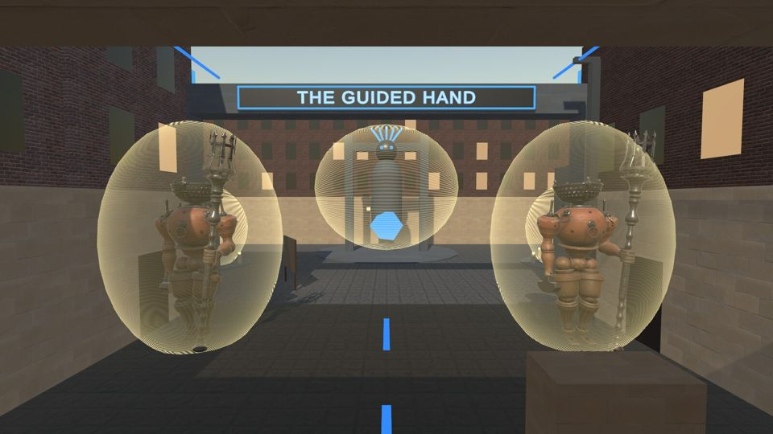
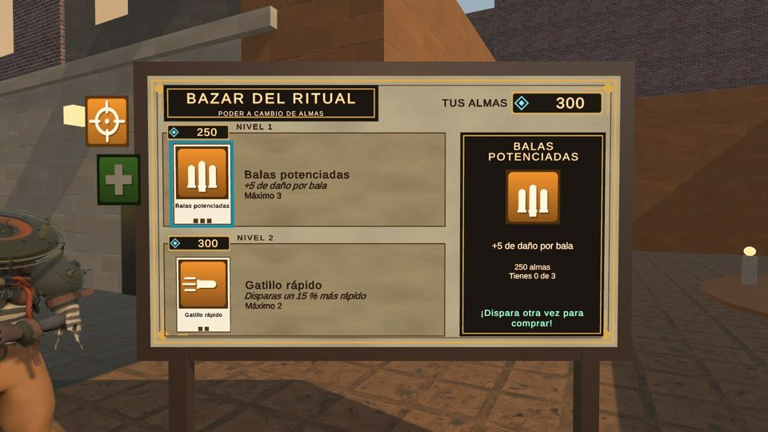
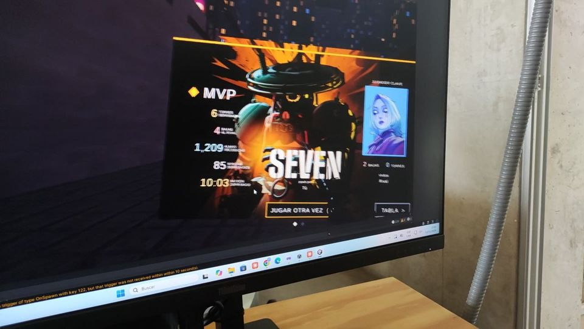
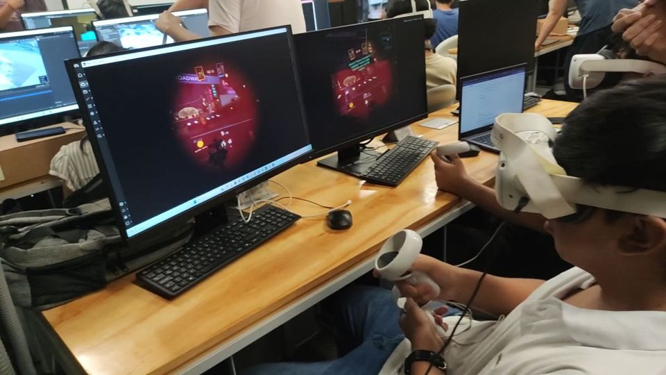
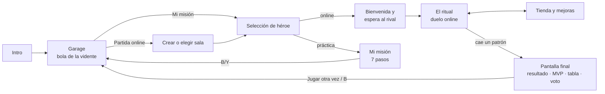
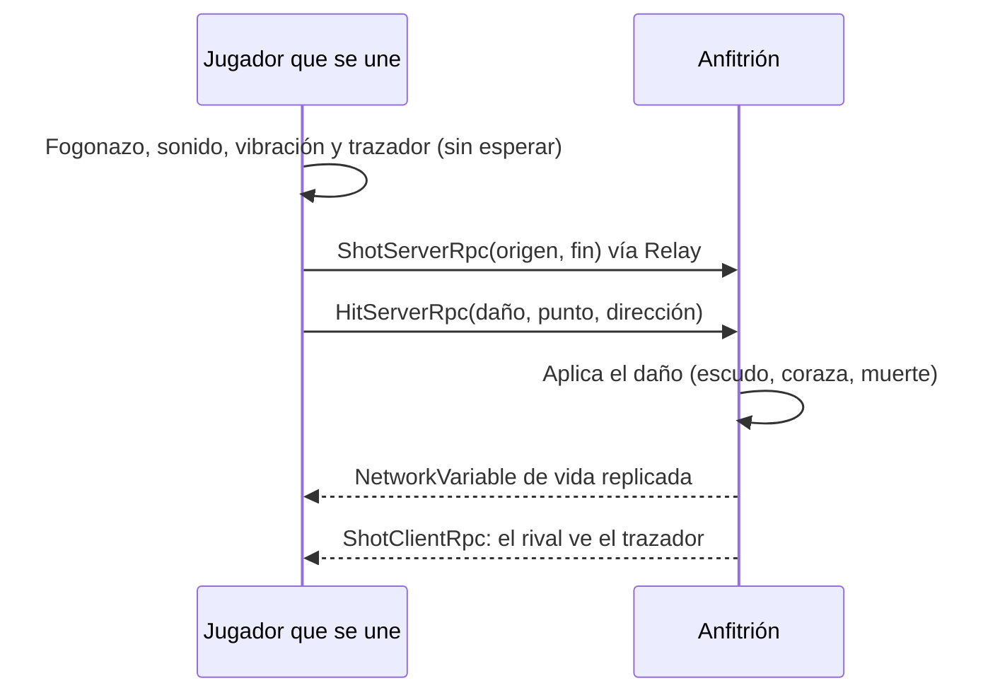

<div align="center">

# Mini Deadlock VR

**Duelo de realidad virtual 1 contra 1 para Meta Quest, inspirado en la progresión de *Deadlock***


Proyecto final de **CS2H01 – Interacción Humano-Computador** · UTEC, ciclo 2026-2 · Prof. Teófilo Chambilla

</div>

---

## Contenido

- [Descripción](#descripción)
- [Recursos de la entrega](#recursos-de-la-entrega)
- [Características](#características)
- [Capturas](#capturas)
- [Tecnologías](#tecnologías)
- [Inicio rápido](#inicio-rápido)
- [Controles](#controles)
- [Arquitectura](#arquitectura)
- [Estructura del repositorio](#estructura-del-repositorio)
- [Evaluación con usuarios](#evaluación-con-usuarios)
- [Historial de desarrollo](#historial-de-desarrollo)
- [Equipo y créditos](#equipo-y-créditos)

## Descripción

En **Mini Deadlock VR** dos personas se enfrentan en *el ritual*: cada una elige un héroe (Seven o Vindicta), farmea minions para recoger almas, compra mejoras, sube de nivel sus habilidades y avanza destruyendo una cadena de objetivos hasta derrotar al patrón del rival. Al terminar, una pantalla de resultados muestra al ganador, al jugador más valioso y la tabla de la partida, y registra cada partida para medir la experiencia con el marco HEART.

El proyecto se diseñó con un enfoque centrado en el usuario: en VR no hay manual, así que el jugador debe entender qué hacer en los primeros segundos. Por eso la entrada es un espacio 3D que se recorre (el *garage*), existe una práctica guiada sin conexión (**Mi misión**) y toda la interacción usa pocos gestos y siempre los mismos: casi todo se hace disparando.

## Recursos de la entrega

| Recurso | Enlace |
|---|---|
| Video de demostración (partida online completa) | [Google Drive](https://drive.google.com/drive/folders/16UVDVmIcmz5RZQKy1x8Up_Fg00LaUKAt?usp=sharing) |
| Videos de las pruebas con usuarios | [Google Drive](https://drive.google.com/drive/folders/1zg0Zm3IIX3Rw4XsEQZRlUHqb7naBvKhA?usp=sharing) |
| Manual de instalación y despliegue | [docs/MANUAL_INSTALACION.md](docs/MANUAL_INSTALACION.md) · [PDF en Drive](https://drive.google.com/drive/folders/1jH5tQB7KM3BYZJqmgYAxHuJw7nP5mjb6?usp=sharing) |
| Todas las evidencias de la entrega final | [Google Drive](https://drive.google.com/drive/folders/1qg0gdkJRYxSr9P_yFlUnj3Mmmw9znrjK?usp=sharing) |
| Notas técnicas detalladas (pasos de construcción, decisiones, problemas) | [CLAUDE.md](CLAUDE.md) |

El informe final (LaTeX/PDF) se entregó por Canvas.

## Características

**Partida**
- Duelo online 1 contra 1 entre dos visores: crear una sala o elegirla de una lista, bienvenida sincronizada y arranque simultáneo.
- Dos héroes con estadísticas propias y dos habilidades cada uno (A y X), con diez niveles y tres mejoras por habilidad.
- Cadena de cinco objetivos por bando (Guardián → Walker → Guardianes de base → Santuarios → Patrón), protegidos con escudo hasta que cae el anterior; el patrón tiene dos fases.
- Oleadas de minions, campamentos neutrales y almas que se recogen disparándoles.
- Tienda de 15 objetos en tres categorías (Arma, Vitalidad, Espíritu), en la sala de aparición y en un quiosco junto a la primera torre.
- Pantalla final en tres tiempos (resultado, jugador más valioso y tabla) con voto y "Jugar otra vez".

**Experiencia y comodidad**
- Garage 3D como menú principal: se camina hasta la bola de la vidente y se la golpea para elegir el modo.
- **Mi misión**: práctica guiada de siete pasos, sin conexión y sin poder morir; el juego recuerda si ya se completó.
- Movimiento con joystick, giro por pasos de 45° y viñeta de confort activada por defecto; tirolesa para los trayectos largos.
- Panel del jugador que sigue la mirada unos 17° bajo el horizonte y solo aparece cuando hace falta, y barra superior con los retratos y el reloj.
- *Feedback* por varios canales: fogonazo, trazador, sonido y vibración por evento, borde rojo al recibir daño, aviso antes del disparo de una torre y vista en gris al caer.
- Subtítulos en todas las frases y volumen ajustable.

**Medición**
- Cada partida se registra en `matches.jsonl` y `events.jsonl` con los datos de las métricas HEART (resultado, duración, almas, compras, nivel, voto, "Jugar otra vez", etc.).

## Capturas

| | |
|:---:|:---:|
|  |  |
| El garage: al golpear la bola aparecen los modos de juego | Panel del jugador: almas, munición, habilidades y vida |
|  |  |
| Objetivos protegidos por el escudo dorado | La tienda: se compra con dos disparos |
|  |  |
| Pantalla final: jugador más valioso | Duelo durante la prueba con usuarios |

## Tecnologías

| Área | Herramienta |
|---|---|
| Motor | Unity **2022.3.62f3 LTS**, Universal Render Pipeline 14.0.12 |
| Lenguaje | C# |
| Realidad virtual | Meta XR SDK 201.0.0, Oculus XR Plugin 4.5.5, Input System |
| Red | Netcode for GameObjects 1.12.0, Unity Relay 1.2.0, Unity Lobby 1.3.0 |
| Modelos | glTFast 6.16.1; esqueletos y animaciones hechos en Blender (scripts en `Tools/`) |
| Visor | Meta Quest 2, 3 o Pro con controladores (sin seguimiento de manos) |

## Inicio rápido

> La guía completa, con requisitos, configuración del visor, servicios online y solución de problemas, está en el **[manual de instalación y despliegue](docs/MANUAL_INSTALACION.md)**.

**Ejecutar en el editor (desarrollo)**

1. Clonar el repositorio y abrirlo con Unity **2022.3.62f3** desde Unity Hub.
2. Conectar el Quest al PC y activar **Quest Link**.
3. Pulsar **Play**. El juego arranca en `Intro`; para jugar directamente la escena abierta, desactivar **Deadlock → Play From Title Screen**.

**Instalar en el visor (APK)**

1. **File → Build Settings → Android → Switch Platform** y compilar con las cuatro escenas en orden: `Intro`, `TitleScreen`, `HeroSelect`, `Lane`.
2. Instalar el APK con Meta Quest Developer Hub o con `adb install -r MiniDeadlock.apk`.
3. Para jugar online, **los dos visores deben tener el mismo APK**, compilado desde el mismo commit: las salas llevan una huella de la versión y el juego rechaza las de otra versión.

## Controles

| Acción | Control |
|---|---|
| Moverse | Stick izquierdo (hacia donde se mira) |
| Girar | Stick derecho (pasos de 45°) |
| Disparar, recoger almas y comprar | Gatillo derecho (comprar: dos disparos al objeto) |
| Habilidades | **A** (control derecho) y **X** (control izquierdo) |
| Panel de mejoras de habilidad | Clic del stick izquierdo (un "!" dorado avisa que hay puntos) |
| Recargar | Clic del stick derecho (también recarga sola al vaciar el cargador) |
| Tirolesa | Grip izquierdo cerca de la cuerda; soltar para bajar |
| Menús del garage | Láser desde el control y cualquiera de los dos gatillos |
| Volver al garage | Mantener **B** o **Y** durante 1,2 s (cierra la sala online) |
| Pantalla final | Rayo desde la mano derecha y gatillo; stick para cambiar de página; **A/X** jugar otra vez, **B/Y** garage |

## Arquitectura

### Flujo de la aplicación



### Módulos

El código está en `Assets/Scripts`, organizado en doce módulos. Los módulos se comunican mediante un bus de 13 eventos (`GameEvents`): daño, muertes, almas, compras, torres caídas, cambios de estado y pistas.

| Módulo | Scripts | Responsabilidad |
|---|:---:|---|
| `UI` | 21 | Panel del jugador, pistas, tablero de salas, menús del garage, láser |
| `Core` | 18 | Sesión, estado de la partida, eventos, registro de estadísticas, Mi misión |
| `Network` | 15 | Jugador en red, vida, almas, estructuras, salas, bienvenida y arranque sincronizados |
| `Economy` | 10 | Cartera de almas, tienda, mejoras y niveles del héroe |
| `Experience` | 8 | Sonido, vibración por evento, vista al morir, pantalla final |
| `Combat` | 8 | Arma, vida, habilidades y sus efectos |
| `Structures` | 7 | Cadena de objetivos, escudos, fases del patrón |
| `Player` | 6 | Locomoción, viñeta de confort, manos, tirolesa |
| `Minions` | 6 | Oleadas, recorrido y ataque de los minions |
| `Lobby` | 4 | Bola de la vidente y runas del garage |
| `Visual` | 3 | Luces y post-proceso según la plataforma |
| `Neutrals` | 2 | Campamentos neutrales con almas extra |

Los valores del juego (2 héroes, 4 habilidades, 6 minions y 15 objetos) son *ScriptableObjects* en `Assets/Data`, así que el balance se ajusta sin tocar código. Las escenas no se editan a mano: los scripts de `Assets/Editor` las construyen con el menú **Deadlock → Setup → 1…36**. Así cada cambio de escena queda en código, que se puede revisar y fusionar en Git.

### Modelo de red

La partida usa un **anfitrión autoritativo**. Quien crea la sala crea los minions, las estructuras y las almas, y es el único que aplica el daño. El otro jugador ve copias sincronizadas. Para que la respuesta se sienta inmediata, cada jugador ve y siente su propio disparo en su visor sin esperar a la red. Solo el daño pasa por el anfitrión.



## Estructura del repositorio

```text
unity2/
├── Assets/
│   ├── Scripts/      Código del juego (12 módulos)
│   ├── Editor/       Menú Deadlock/Setup (construcción de escenas) y herramientas de depuración
│   ├── Data/         Héroes, habilidades, minions y objetos (ScriptableObjects)
│   └── Scenes/       Intro, TitleScreen, HeroSelect, Lane
├── Tools/            Scripts de Blender y .blend de esqueletos, animaciones y props
├── Capturas/         Capturas usadas en los informes de cada avance
├── docs/             Manual de instalación y despliegue, e imágenes del README
├── CLAUDE.md         Notas técnicas detalladas del desarrollo
└── README.md
```

## Evaluación con usuarios

El 17 de noviembre de 2026 se evaluó el prototipo con **cinco estudiantes con experiencia intermedia en VR**. El juego estaba instalado como APK en los Meta Quest del laboratorio: el cable USB solo cargaba el visor, y su vista se transmitía al monitor con Meta Quest Developer Hub. Cada participante hizo la práctica y luego jugó un duelo online contra otra persona. Después respondió el SUS, un cuestionario de inmersión y comodidad y una entrevista. Cada sesión se grabó mostrando la vista del visor y al participante.

| Medida | Resultado |
|---|---|
| SUS (usabilidad percibida) | **70,0 / 100** (DE 5,9), sobre el promedio de referencia de 68 |
| Subescalas del SUS | Usabilidad 75,6 · Facilidad de aprendizaje 47,5 |
| Inmersión y presencia | **4,35 / 5** |
| Emoción y diversión | 4,4 / 5 |
| Comodidad | 1 de 5 participantes con mareo; ninguno con fatiga |

**Hallazgos principales**
- Lo que más gustó fue **el duelo contra otra persona** (4 de 5 entrevistas).
- La facilidad de aprendizaje es el área de mejora. Las mejoras de habilidad no se descubrían solas, Mi misión no enseñaba lo agregado en la última versión, y ningún participante siguió la pista del garage sin ayuda.
- Los ocho hallazgos, con su evidencia y la mejora propuesta para cada uno, están en el informe final.

## Historial de desarrollo

El proyecto se construyó en cinco entregables incrementales. Cada uno se probó en el editor y en el visor.

<details>
<summary><b>Avance 1 · semana 10 · 15 %</b>: menú, selección de héroe y carril de combate</summary>

- **Pantalla de título (RF-01)** con "PARTIDA ONLINE" y "MI MISIÓN". El juego guarda con `PlayerPrefs` si el jugador pidió o completó la misión (base de RF-04).
- **Selección de héroe (RF-02).** Seven y Vindicta, cada uno definido en un `HeroDefinitionSO` (`Assets/Data/Heroes`). Al elegir suena la línea del héroe y aparece su modelo 3D. Al confirmar se reproduce la intro de su patrón (Hidden King / Archmother) con subtítulos (RNF-08).
- **Interfaz espacial (RNF-04):** menús en el mundo, manejados con un puntero láser.
- **Carril de combate (RF-15):** calle bajo el puente con coberturas, camino de minions por *waypoints* (`LanePath`) y un `WaveSpawner` por bando.
- Torre Guardián (RF-12), minions y almas (base de RF-07), arma por héroe y registro de estadísticas (`MatchStatsRecorder`, base de RF-16).

[Video del avance 1](https://drive.google.com/file/d/1IiGOef0nJiV59oh0wmfgiim7o4Hq63hf/view?usp=sharing)
</details>

<details>
<summary><b>Avance 2 · semana 11 · 30 %</b>: base online, movimiento con confort y menús en 3D</summary>

**Partida online 1 contra 1 (RF-08)**
- `DuelMatchmaker` entra a una sala abierta o crea una de dos jugadores (Lobby + Relay + Netcode). El anfitrión juega del lado Amber y el que se une, del lado Sapphire.
- `NetworkPlayer` sincroniza la cabeza, las manos, el héroe y el arma de cada jugador.
- Solo se juntan jugadores con el mismo *build*, porque las salas llevan una huella de la configuración de red. Si dos jugadores crean sala a la vez, el de la sala más nueva se pasa a la más antigua. Las salas abandonadas se descartan a los 12 s. Mientras se espera, se muestra el código de sala.

**Movimiento con confort (RF-05, RNF-02)**
- `ComfortLocomotion`: el stick izquierdo mueve y el derecho gira en pasos de 45°, con viñeta de confort activada por defecto.

**Menús en 3D**
- **Intro** inspirada en la de *Deadlock*: azotea al atardecer, logo de la rueda, música de título y "pulsa cualquier botón para empezar".
- **El garage** reemplaza al menú plano. Es la sala de la vidente: se camina hasta la bola de cristal y se la golpea para que aparezcan "Partida online", "Mi misión" y los ajustes de volumen y subtítulos (RNF-08).
- **Selección de héroe en 3D** ("visión espiritual"): los héroes aparecen como espíritus y se confirma con una runa.
- **Volver atrás:** runa ATRÁS o B/Y en la selección de héroe; en el carril se mantiene B/Y para volver al garage, lo que cierra la sala online.
- Textos con brillo en todos los menús, y clic del láser con cualquiera de los dos gatillos (diestros y zurdos).

**Combate y manos**
- Disparo con fogonazo, bala visible, trazador, impacto y sonido. Los minions tienen barra de vida y se desvanecen al morir.
- Manos con guante sobre los controles: los dedos siguen al gatillo y al grip, y la mano derecha sostiene el arma.

**Pruebas.** La base online se probó en el laboratorio con dos Quest por Quest Link. Los menús 3D, las manos y los efectos de combate se verificaron en el editor y se probaron con el visor en el avance 3.

[Video del avance 2](https://drive.google.com/drive/folders/1KlLehCYPxNFCByumKlzJycKDKqtouJvJ?usp=sharing)
</details>

<details>
<summary><b>Avance 3 · semana 12 · 50 %</b>: partida online completa, disparo, almas y Mi misión</summary>

**Partida online completa (RF-08, RF-09, RNF-03)**
- **Anfitrión autoritativo:** el anfitrión crea y mueve los minions, las torres y las almas; el que se une los ve como copias (`NetworkHealth`, `NetworkTransform`, `NetworkSoul`, `NetworkTower`). Nada aparece hasta que los dos están listos (`MatchNet`).
- **Crear o elegir sala:** las runas CREAR SALA y ELEGIR SALA muestran una lista de hasta cuatro salas abiertas, con el nombre de la sala, el héroe del anfitrión y las plazas libres (`RoomBoard`, `RoomBrowser`, `OnlineIntent`). Si una sala es de otra versión, ya no existe o está llena, el juego lo dice. Si el anfitrión no responde en 12 s, avisa y deja volver.
- **Bienvenida y arranque a la vez:** con los dos jugadores en la sala, cada uno escucha la bienvenida de su héroe. La partida empieza para ambos al mismo tiempo (`WelcomeSequence`, `MatchStartSync`).
- **Corrección de conexión:** la huella de la sala se calculaba antes de registrar los *prefabs* de red, y el anfitrión rechazaba al otro jugador con "NetworkConfig mismatch".

**Disparo, daño y almas (RF-06, RF-07)**
- Los disparos del que se une viajan al anfitrión, que aplica el daño. Los dos ven las mismas barras de vida, las mismas muertes y el trazador del rival.
- Cada jugador tiene un cuerpo que puede ser golpeado y reaparece a los 5 s en su lado.
- Las almas se recogen disparándoles: el primero que dispara se las lleva y el anfitrión le paga.
- Una torre Guardián por bando (`StructureSpawner`).

**Mi misión: práctica guiada (RF-03, RF-04, RF-13, RNF-05)**
- Práctica sin conexión de seis pasos, con un panel de pistas que sigue la mirada (`MissionGuide`, `HintBoard`): caminar, girar, disparar, eliminar un minion, recoger un alma y destruir la torre. Cada paso avanza cuando el jugador lo hace.
- Al terminar aparece "¡MISIÓN CUMPLIDA!" y el garage deja de recomendarla. En la práctica no se puede morir y solo juega el bando rival.

**Mundo y personajes**
- **Mapa "mini Broadway" (RF-15, RNF-05).** El carril pasó de una calle de 60 × 14 m a un mapa de unos 190 × 80 m inspirado en el carril central de *Deadlock*. Tiene la plaza Times Square en el centro, cuatro distritos con coberturas (Haunted Lot, Chinatown, Fairfax Plaza y Theater), una base por bando con su arco y carteles de neón para orientarse.
- Teleportadores entre la base y el carril, con fundido a negro para evitar el mareo.
- Esqueleto y animaciones para los héroes, la torre Guardián (que apunta antes de disparar) y los seis minions. El Medic pelea y, al morir, suelta un orbe que cura a quien lo eliminó.
- Sonido ambiente propio en cada escena.

**Pruebas.** Mi misión se probó con el Quest en el laboratorio. El duelo online se verificó con el editor como anfitrión y un cliente de Windows, y luego se demostró en vivo en clase. Capturas en `Capturas/Entrega3`.

[Video del avance 3](https://drive.google.com/drive/folders/1HYkEiQKu8cs_IuhzPMskc_Ofp67i7_Os?usp=sharing)
</details>

<details>
<summary><b>Avance 4 · semana 13 · 70 %</b>: objetivos en secuencia, habilidades y tienda</summary>

**Objetivos en secuencia y patrón final (RF-12)**
- Cada bando defiende una cadena: Guardián → Walker → 2 Guardianes de base → 2 Santuarios → Patrón, cada uno con más vida que el anterior.
- Un objetivo tiene escudo (burbuja dorada) mientras quede en pie otro de menor nivel de su bando, y los minions no lo atacan. El anfitrión decide los escudos y el rival los ve igual (`NetworkStructure`).
- Al caer el patrón termina el ritual con "¡VICTORIA!" o "DERROTA" y la frase del héroe (`MatchOutcome`). Cada objetivo que cae se anuncia junto con el siguiente.

**Habilidades (RF-10)**
- Dos por héroe, con A y X, apuntadas con la mano derecha y con enfriamiento (`AbilityCaster`, datos en `Assets/Data/Abilities`). Seven tiene *Bola relámpago* y *Nube de tormenta*; Vindicta, *Estaca* y *Asesinar*. El rival ve cada habilidad (`AbilityFx`).
- Panel en la muñeca izquierda con las almas, las habilidades y el siguiente objetivo (`WristHud`).

**Tienda (RF-11)**
- Tablero en cada base con la organización de la tienda de *Deadlock* y arte propio (`ShopBoard`, `ShopTab`, `ShopCard`).
- **Se compra disparando**: el primer disparo selecciona el objeto y explica qué hace, y el segundo lo compra. Mantener el gatillo apretado no compra nada.
- Cinco objetos con tope de compras. Cada carta indica cuántos tienes y se pone gris si no te alcanzan las almas. La tienda del rival está sellada.

**Mi misión.** Se agregó un paso para usar una habilidad, y el último paso recuerda la tienda.

**Pruebas.** Se verificaron en el editor la cadena con escudos, la victoria, las compras y la tienda rival. Mi misión, las habilidades y la tienda se probaron con el Quest en el laboratorio. Capturas en `Capturas/Entrega4`.

[Video del avance 4](https://drive.google.com/drive/folders/16GJri4Z4-nQk6Hxok25Aae96aXfF9nmL?usp=sharing)
</details>

<details>
<summary><b>Avance 5 · semana 14 · 100 %</b>: versión final, pantalla de resultados y evaluación con usuarios</summary>

**Pantalla final y registro de la partida (RF-14, RF-16)**
- Al caer un patrón, el mundo se congela y la pantalla final llega en tres tiempos. Primero, la vista se tiñe del color del bando ganador. Después aparece el jugador más valioso. Por último, la tabla de la partida con el voto "Me gusta / No me gusta" y "Jugar otra vez" (`ResultScreen`). Se usa con un rayo desde la mano y el gatillo.
- Cada partida escribe una línea en `matches.jsonl`, y los eventos sueltos van a `events.jsonl` (`MatchStatsRecorder`). Las rutas están en el [manual](docs/MANUAL_INSTALACION.md#9-registros-para-la-evaluación-heart).
- El ritual ya no tiene tope de tiempo: termina solo cuando cae un patrón. Para acortarlo, las estructuras tienen un 40 % menos de vida.

**Progresión, habilidades y tienda**
- Niveles del 1 al 10 por almas recogidas. Cada nivel da vida, daño, poder y un punto de habilidad, con tres mejoras por habilidad (`HeroProgression`).
- Las habilidades se rehicieron con el comportamiento del juego original. Las estadísticas de cada héroe salen de la wiki, escaladas a un duelo en VR.
- Tienda de 15 objetos en tres categorías, también disponible en un quiosco junto a la primera torre.

**Mapa, interfaz y sensaciones**
- Mapa más grande, con salas de aparición de vidrio y modelos reales del Walker, los santuarios, los guardianes de base y los patrones. Cada objetivo tiene su propio ataque. Una tirolesa reemplaza a los teleportadores.
- Un panel que sigue la mirada reemplaza al de la muñeca. Se agregó la barra superior con los retratos de los héroes y el reloj.
- `ExperienceDirector` agrega vibración por evento, borde rojo al recibir daño y aviso antes del disparo de una torre. `DeathView` muestra la vista en gris al caer y al rival caído como fantasma. `InputGate` bloquea la entrada durante la bienvenida.
- Optimización para el Quest: se retiraron 38 cámaras de captura olvidadas en la escena, y el carril pasó de unos 10 FPS a unos 5,9 ms por cuadro, medido en el editor por Quest Link.

**Pruebas.** La partida online completa se jugó con dos Quest y quedó en el video de demostración. Las pruebas con usuarios del 17/11 se resumen en [Evaluación con usuarios](#evaluación-con-usuarios).
</details>

## Equipo y créditos

| Integrante |
|---|
| Rolando David Diaz Jara |
| Jordinn Martin Reyes Medina |
| Segundo Fernando Aguilar Delgado |

Proyecto académico del curso CS2H01 – Interacción Humano-Computador (UTEC, 2026-2), a cargo del profesor Teófilo Chambilla.

Los modelos, voces y música de los héroes, minions y objetivos provienen de *Deadlock* (Valve Corporation) y se usan **solo con fines académicos**. Las texturas del mapa son de dominio público (CC0, [Poly Haven](https://polyhaven.com)). Los sonidos del disparo y del impacto, y el arte de la tienda, son propios.
